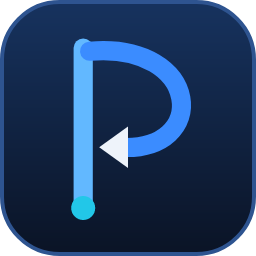
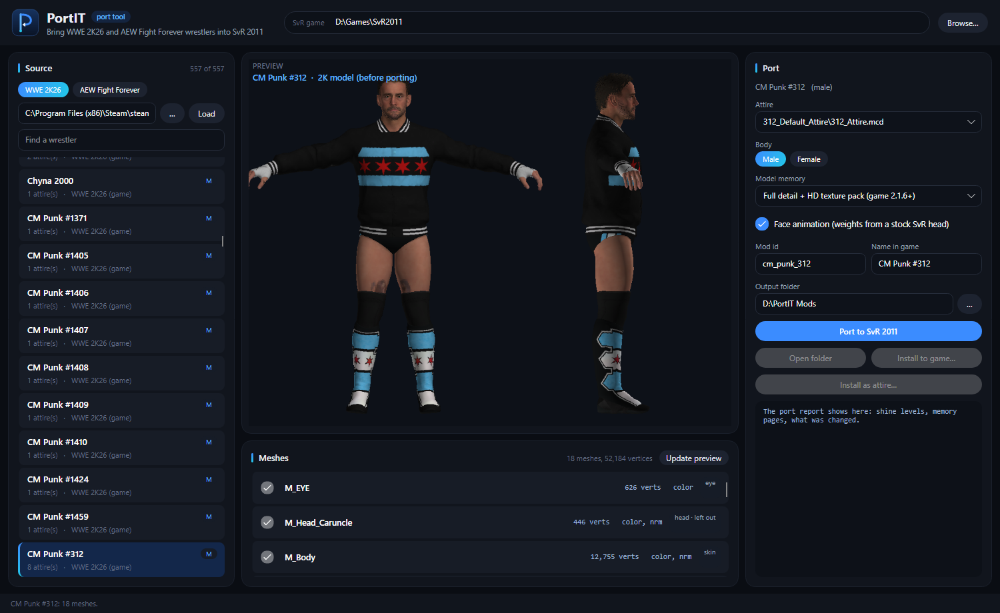

<p align="center">
  
</p>

<h1 align="center">PortIT</h1>

<p align="center">
  <b>Port wrestlers from WWE 2K19 – 2K26 and AEW Fight Forever into WWE SmackDown vs. Raw 2011 (PC port) —<br>
  full detail, HD textures, working face animation.</b>
</p>

<p align="center">
  <a href="../../releases/latest"><b>Download</b></a> ·
  <a href="docs/USER_GUIDE.md"><b>User guide</b></a> ·
  <a href="https://discord.gg/EfprRmbEt2"><b>Discord</b></a> ·
  <a href="bigmodel_dll">Big-model DLL source</a>
</p>



## Quick start

1. Download **`PortIT-<version>-win-x64.zip`** from [Releases](../../releases/latest), unzip it anywhere and run
   **`PortIT.exe`** (no install: everything is inside).
2. Choose your SvR 2011 game folder, then click **Big-model DLL…** and **Install** (needed for full-detail models and
   their HD textures; [how and why](docs/USER_GUIDE.md#the-big-model-dll-for-full-detail)). Start the game once.
3. Choose your source - the WWE 2K26 game folder, a folder of 2K mods (2K19 – 2K26), one wrestler's model folder
   (**Model folder…**: it opens at once) or AEW's `paks` folder - click **Load**, pick a wrestler, choose
   **Full detail + HD texture pack** and click **Port to SvR 2011**.
4. **Install to game…** (a new superstar) or **Install as attire…** (a new look for a superstar the game has).

Everything is explained step by step in the **[user guide](docs/USER_GUIDE.md)**.

## What PortIT does

- **Reads the wrestlers straight from your own games**
  - **WWE 2K26**: point it at the WWE 2K26 game folder (all wrestlers are read from its archives).
  - **WWE 2K19 – 2K26 mods**: a folder of 2K wrestler mods, or one wrestler's model folder (**Model folder…**) -
    `.mcd` (2K25, 2K26), `.mdl` (2K20, 2K22, 2K23, 2K24) or `chNNNNN.pac` packs (2K19 – 2K22, the older Yuke's
    format). No game install needed.
  - **AEW Fight Forever**: the PS4 dump's `...\CUSA34641\elite\content\paks` folder.
- **Preview before porting** — see the wrestler as he or she is, untick clothes, gear or hair to leave them out, and
  draw the preview again with that edit.
- **Full detail + HD texture pack** (game 2.1.6 or newer, with PortIT's big-model DLL) — every vertex of the source
  model, and every texture at its full size in a texture pack. Six such wrestlers have run a 6-man match at 60 fps.
  Without the DLL, or on older games, the model is simplified to fit the game's normal memory.
- **3D view** — turn the built model with the mouse like in Blender (drag to turn, wheel to zoom close, front / side /
  back / top keys, wireframe), with its HD textures.
- **Moving hair (test)** — long hair and braids swing in matches like the game's own long-haired superstars: PortIT
  adds hair bone chains and the game's hair settings. Try it first in the 3D view's **Hair** buttons (the head moves,
  or you turn the wrestler yourself and the hair reacts).
- **Body type, height and moveset** — pick the game's superstar underneath the port (his size in the game, his moves,
  entrance and stats; the Divas also give a woman's body), make the wrestler taller or shorter (0.80 – 1.25), and take
  the moves and taunts of any superstar of the game.
- **Faces that move** — a stock SvR head's face rig is fitted onto the new face, so the game's own face animations
  (talking, yelling, selling) work. Which skin is upper lip and which is lower comes from the source game's own data
  (2K's FACS jaw-open shape, AEW's lip and jaw bones), the mouth corners stay round, and AEW wrestlers keep their own
  teeth, gums and tongue.
- **Face paint** — 2K26 face paint (a paint layer, or an attire's own face textures: Ultimate Warrior, Umaga, Tama
  Tonga's FacePaint look…) is laid on the face as the game does it, in the preview and in the port.
- **No glazed look** — SvR's skin shine is worked out from the source materials instead of copied; each wrestler's
  normal maps are checked so the muscle detail is lit the right way round.
- **Clothes and hair that follow the body** — tight gear moves with the skin under it, the skin under it is hidden,
  hair and beard cards keep their real colour and follow the face.
- **Checks in every report** — face points that would swing too far, gear that would drift from the skin, and the
  game's hard limits (a model that would crash is never handed out).
- **Install** — as a new superstar (`Mods\Superstars`), or as an **attire** of a superstar the game has (a new attire,
  or replacing one; the same rules as the Mod Maker's Attires page). The HD textures go into your enabled texture pack,
  at the size you pick (4K by default, about 21 MB a wrestler; 8K or 2K). The big-model DLL installs from PortIT too.
- **`.svrmod`** — every port is also saved as a `.svrmod`, so you can open it in the **Mod Maker** and edit the name,
  stats, moves, entrance and so on. The HD textures come in a zip for the `Texture Packs` folder, and a
  **`… - SHARE THIS (model + HD textures).zip`** holds both, ready to share.

## What you need

- **Windows 10 / 11** (64-bit) and the **SvR 2011 PC port** (2.1.6 or newer for full detail; its `pac\ch` stock
  models are the templates).
- Your own copy of **WWE 2K26**, 2K wrestler mods (2K19 – 2K26), and/or the files of your own **AEW Fight Forever**
  (PS4). No `oo2core` DLL is needed for AEW or 2K19 – 2K22 packs: PortIT unpacks Oodle Kraken itself.
- The release download has everything else inside.

## Found a bug?

**The quickest way is the "Report a problem…" button in PortIT** (top right, since 1.3.2). It asks for a link to the
model and what went wrong, attaches PortIT's log if you let it, and sends it straight to me in private - nobody else
sees it. Your Windows user name is removed from the log before it is sent.

You can also open a [new issue](https://github.com/isMrSUL/PortIT/issues/new/choose), or ask in **#help** on the
[Discord](https://discord.gg/EfprRmbEt2).

**To get a problem fixed, I need the model.** Most bugs only happen with one model's files - without them I can't
see the problem or test the fix. Use the Report button, or send the link to the model files to me (SUL) in a
**private message on Discord (DMs)**. Please don't post model links in public channels or GitHub issues, and never
share paid models without the creator's permission.

## Discord

**[discord.gg/EfprRmbEt2](https://discord.gg/EfprRmbEt2)** - SUL Modding, the home of PortIT and AnimIT: help when a
port goes wrong, a ping when a new version comes out, and a place to show the wrestlers you make.

## Build from source

You need the [.NET 10 SDK](https://dotnet.microsoft.com/). Since 1.2.0 the engine is C# and runs inside PortIT.exe;
no Python is needed.

```
cd app
dotnet build -c Release
bin\Release\net10.0\PortIT.exe
```

The release zip is made with `tools\make_release.ps1` (see the script for its options). The big-model DLL is built
with `bigmodel_dll/build.sh` ([Zig](https://ziglang.org/) 0.13).

## Project layout

| Folder | What it is |
|---|---|
| `app/` | the Avalonia app (C#) |
| `app/EngineNet/` | the engine (C#, runs inside PortIT.exe): `Worker.cs` takes the app's requests; `Readers/` the 2K `.mcd`, 2K19 - 2K22 pack, UE4 IoStore / zen and PS4 texture readers; `Port/` the face fit, weights, texture sheets and packs, checks, previews, attire mods, the AEW bridge, the entrance outfit; `Build/` the SvR 2011 model builder; `Formats/`, `Imaging/` file formats and image code |
| `app/EngineNet.Check/` | the checker that compared the C# engine with the old Python engine, piece by piece (`ref/*_ref.py` make the Python side); the plan and results are in `app/EngineNet/PORT_PLAN.md` |
| `app/Engine/` | the old Python engine (up to 1.1.2), kept for comparing: PortIT runs it when `PORTIT_PYTHON_ENGINE=1` is set and it sits beside PortIT.exe. `Engine/cake/` (the 2K26 archive reader, BakeIT.Core) and `Engine/bigmodel/` ship with PortIT |
| `bigmodel_dll/` | the source of the optional big-model DLL (`xinput1_4.dll`) for full-detail wrestlers |
| `docs/` | the [user guide](docs/USER_GUIDE.md) and its pictures |
| `tools/` | `make_release.ps1`: builds the release zips |

## Credits

Made by **SUL (MrSUL)**, with [Claude Code](https://claude.com/claude-code) as the coding assistant.

The SvR 2011 model builder and format code (`app/EngineNet/Build`, `Formats`; the Python originals in `app/Engine/svr`)
started from the tools of the
[WWE SmackDown vs. Raw 2011 PC port](https://github.com/KaikoClanworth1/wwe-svr2011-pc) (MIT, KaikoClanworth1 and
the SvR 2011 PC port contributors). See [THIRD-PARTY-NOTICES.md](THIRD-PARTY-NOTICES.md).

## License and credit

PortIT is free and open source under the [MIT License](LICENSE). You may use it, change it, make your own version of
it and share it - the only condition is to **keep the copyright notice (Copyright (c) 2026 MrSUL) and the license**
in your copy. If you make your own version or use PortIT's code in your project, please **credit SUL (MrSUL)** and
link back to this page. Thank you!

No game files are included; PortIT reads your own copies of the games.

WWE, SmackDown vs. Raw, WWE 2K and AEW Fight Forever are trademarks of their owners. PortIT is a free fan-made
modding tool and is not affiliated with or endorsed by WWE, Yuke's, THQ, 2K, Visual Concepts, AEW or THQ Nordic.
