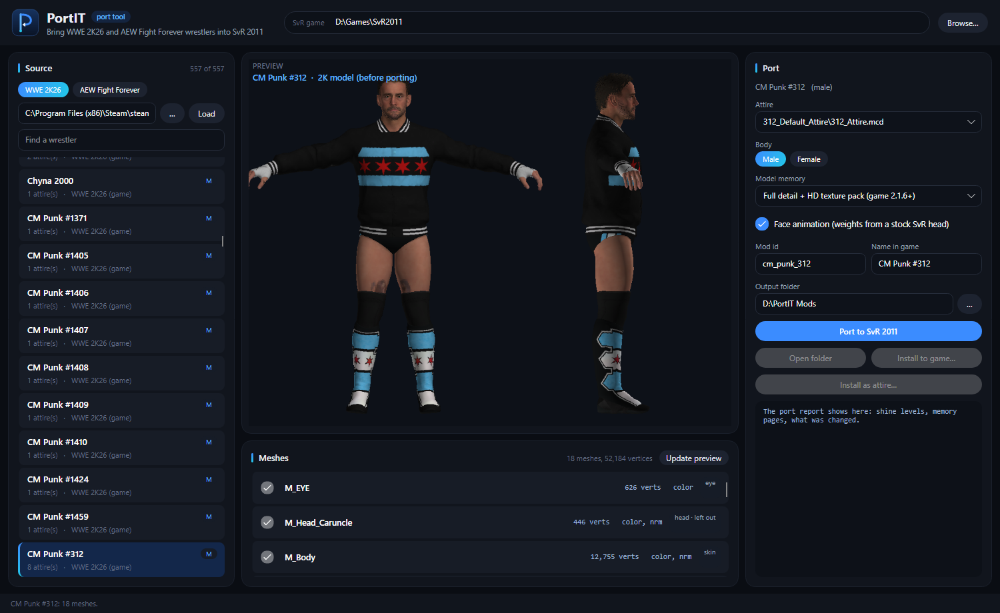
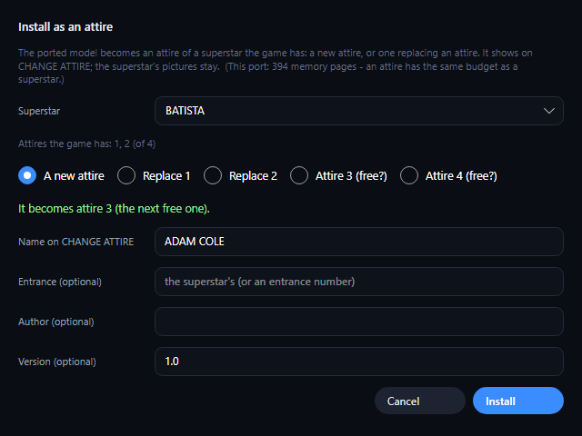
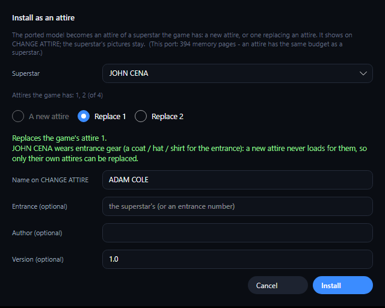

# PortIT user guide

PortIT takes a wrestler from **WWE 2K19 – 2K26** or **AEW Fight Forever** and makes a mod for the
**WWE SmackDown vs. Raw 2011 PC port**: a new superstar, or a new look (attire) for a superstar the game already has.

This guide goes step by step. If something goes wrong, see [When something goes wrong](#9-when-something-goes-wrong).

**Contents**

1. [What you need](#1-what-you-need)
2. [Get PortIT](#2-get-portit)
3. [The window](#3-the-window)
4. [Port a wrestler, step by step](#4-port-a-wrestler-step-by-step)
5. [The choices on the right, explained](#5-the-choices-on-the-right-explained)
6. [Put the wrestler in your game](#6-put-the-wrestler-in-your-game)
7. [Share it, or edit it in the Mod Maker (.svrmod)](#7-share-it-or-edit-it-in-the-mod-maker-svrmod)
8. [Tips and limits](#8-tips-and-limits)
9. [When something goes wrong](#9-when-something-goes-wrong)
10. [Where PortIT keeps its files](#10-where-portit-keeps-its-files)

---

## 1. What you need

- **Windows 10 or 11, 64-bit.**
- The **SvR 2011 PC port**, installed and working. PortIT needs the game folder: the one that has the `pac\ch`
  folder inside.
- **For full-detail wrestlers**: game **2.1.6 or newer** *and* **PortIT's big-model DLL** in the game folder (see
  [The big-model DLL](#the-big-model-dll-for-full-detail)). Without the DLL, PortIT still works: it makes the model
  small enough for the game's normal memory, like the *Classic* choice.
- At least one of these, **your own copy**:
  - **WWE 2K26** (PC). PortIT reads the wrestlers straight from the installed game, for example
    `C:\Program Files (x86)\Steam\steamapps\common\WWE 2K26`.
  - **2K wrestler mods from WWE 2K19 to 2K26** - no game needed, just the mod files:

    | Game | What a mod looks like |
    |---|---|
    | 2K25, 2K26 | a folder with `BaseModel\baseModel.mcd` and an attire folder (`…\<id>_Attire.mcd`) |
    | 2K20, 2K22, 2K23, 2K24 | the same, with `.mdl` files instead of `.mcd` |
    | 2K19 – 2K22 packs | `chNNNNN.pac` files (one pack = one look). PortIT unpacks a pack into a cache when you open it. |

    Point PortIT at a folder of such mods or at one wrestler's folder, or open **one model file** with **Model…**.
  - **AEW Fight Forever** (PS4). You need the game's files from your PS4 copy, unpacked to a folder. PortIT reads
    the `paks` folder inside it: `...\CUSA34641\elite\content\paks`.
- About **5 GB of free disk space** for PortIT's work files (2K26 wrestlers are unpacked into a cache the first time
  you open them).

PortIT never changes your 2K26 or AEW files: it only reads them. It writes into the SvR game folder only when you
press an **Install** button.

## 2. Get PortIT

1. Download `PortIT-<version>-win-x64.zip` from the [Releases page](../../../releases/latest).
2. Unzip it anywhere, for example `C:\Tools\PortIT`. Keep all the files together: `PortIT.exe` needs the `Engine`
   folder next to it.
3. Start **`PortIT.exe`**. Nothing to install: .NET and Python are already inside the folder.

> If Windows shows *"Windows protected your PC"*, click **More info**, then **Run anyway**. PortIT is not signed with
> a paid certificate; that is the only reason for the message.

### The big-model DLL (for full detail)

In a match, the game gives each wrestler a fixed amount of memory for the model's shape: 768 KB, about 168
"pages". A full-detail 2K26 or AEW wrestler needs 300–550 pages. A model bigger than its memory crashes the game, so
without help PortIT has to shrink every model to fit.

**PortIT's big-model DLL** gives each wrestler 4 MB (about 1000 pages) instead.

**Install it from PortIT (easiest, PortIT 1.1.0 and newer):** close the game, then click **Big-model DLL…** at the
top of PortIT's window (next to **Browse…**). It explains what the DLL does, shows whether it is installed and
whether the last game start used it, and installs or removes it with one click. If another mod's `xinput1_4.dll` is
there, PortIT keeps it as `xinput1_4.dll.before_portit` (and puts it back if you remove PortIT's). If you choose
*Full detail* without the DLL, PortIT asks whether to install it. After installing, **start the game once**.

**Or install it by hand** (it is also on the [Releases page](../../../releases/latest) as
`PortIT-BigModel-DLL-<version>.zip`):

1. Close the game.
2. In your SvR 2011 game folder (next to `svr2011.exe`), check whether there is already a file called
   `xinput1_4.dll`. If there is, it belongs to another mod: **rename it** (for example to `xinput1_4.dll.old`) to keep
   it. Only one `xinput1_4.dll` can be used at a time.
3. Copy `xinput1_4.dll` from the zip into the game folder, next to `svr2011.exe`.
4. Start the game once. A file `bigmodel.log` appears next to the DLL. Its first lines say whether big models are on:
   - `model memory hook on ...` and `vertex windows ... -> 4096 KB`: it works.
   - `big models off (the game is unchanged)`: your game version is not supported; the DLL changed nothing.
5. In PortIT, choose **Full detail + HD texture pack**. PortIT reads `bigmodel.log` and allows models up to the bigger
   size. While it ports, PortIT shows `vertex window: 4096 KB a wrestler -> models up to 1000 pages`, and the
   report's *game limits* line ends with `(the window takes 1000)`.

**Remove it:** close the game and delete `xinput1_4.dll` (or rename your old one back). Full-detail mods made with
it then need it: without it, port them again with the DLL gone, so PortIT makes them fit.

The DLL only does something inside the game (`svr2011.exe`). The Mod Maker and the launcher, which sit in the same
folder, are not affected. It checks the game's memory table first and changes nothing if it isn't what it expects.
It was tested with SvR 2011 PC port 2.1.9 and 2.2.1. Its source is in the [`bigmodel_dll`](../bigmodel_dll) folder.

## 3. The window

| Part | What it is for |
|---|---|
| **SvR game** (top) | your SvR 2011 game folder (the one with `pac\ch`). Use **Browse…** to pick it. **Big-model DLL…** installs or checks the [big-model DLL](#the-big-model-dll-for-full-detail). |
| **Source** (left) | where the wrestlers come from: **WWE 2K19 - 2K26** or **AEW Fight Forever**, its folder (**…**), one model file (**Model…**), **Load**, a search box and the list of wrestlers. |
| **Preview** (middle) | the wrestler as he or she looks in the source game, from the front and the side. After porting it shows the built SvR model. |
| **Meshes** (middle, bottom) | every part of the model (body, head, eyes, hair, each piece of clothing). Untick a piece to leave it out. |
| **Port** (right) | the choices for the port, the **Port to SvR 2011** button, the install buttons and the port report. |
| Status bar (bottom) | what PortIT is doing right now, or the last message. |

## 4. Port a wrestler, step by step

1. **SvR game**: click **Browse…** at the top and choose your SvR 2011 game folder. PortIT remembers it.
2. **Source**: click **WWE 2K26** or **AEW Fight Forever**.
3. Click **…** next to the source box and choose the folder:
   - WWE 2K: the WWE 2K26 game folder, a folder of 2K wrestler mods (2K19 – 2K26), or one wrestler's folder;
   - AEW: the `paks` folder (`...\CUSA34641\elite\content\paks`).

   **Only want one wrestler?** Click **Model…** instead and open that wrestler's model file: its
   `baseModel.mcd` / `.mdl` (or an attire's), or a `chNNNNN.pac`. No game install is needed.
4. Click **Load**. The list fills with the wrestlers. WWE 2K26 has more than 550; type in **Find a wrestler** to
   search. A number after the name (for example *CM Punk #312*) tells versions of the same wrestler apart.
5. **Click a wrestler.** PortIT reads the model (the first time, a 2K26 wrestler takes a few seconds to unpack) and
   shows the **preview**. Check it is the wrestler and the look you want.
6. **Attire** (right): if the wrestler has more than one look, pick it here. The preview updates.
7. **Meshes**: untick anything you want **left out**, for example a jacket, a hat or a towel. Click
   **Update preview** to see the wrestler without it. (The skin under a removed jacket is kept, so no holes.)
8. Check the choices on the right (see [section 5](#5-the-choices-on-the-right-explained)). In most cases you only
   need: **Model memory = Full detail + HD texture pack**.
9. Click **Port to SvR 2011**. It takes about **one minute**. The bar at the bottom shows each step.
10. When it is done, the preview shows the **built SvR model** and the box under the buttons shows the
    **report** (see [The report](#the-report)).
11. Put it in your game: **Install to game…** or **Install as attire…** (see [section 6](#6-put-the-wrestler-in-your-game)).

## 5. The choices on the right, explained

| Choice | What to pick |
|---|---|
| **Attire** | the wrestler's look, when there is more than one. |
| **Body: Male / Female** | the wrestler's body. It matters for *Classic window* ports. For full-detail ports the model is the same either way. For women, also set a female *base* superstar in the Mod Maker later (see [section 7](#7-share-it-or-edit-it-in-the-mod-maker-svrmod)). |
| **Model memory** | how much detail the model keeps. See below. |
| **HD texture size** | (full detail only) how big the HD texture pack is: **4K** (the default, about 21 MB a wrestler), **8K** (sharpest, about 85 MB a wrestler) or **2K** (about 6 MB). Many ported wrestlers at 8K add up to gigabytes. |
| **Face animation** | leave it **on**. The wrestler then talks, yells and sells with the game's own face animations. |
| **Mod id** | the mod's folder name (letters, numbers and `_` only). Two mods with the same id replace each other. |
| **Name in game** | the name shown in the game (up to 31 characters). |
| **Output folder** | where PortIT saves the finished mods. |

### Model memory

| Option | Use it when |
|---|---|
| **Full detail + HD texture pack (game 2.1.6+)** | **The best choice for game 2.1.6 and newer with the [big-model DLL](#the-big-model-dll-for-full-detail).** Every vertex of the source model is kept, and every texture is saved at its full size in a texture pack. Six such wrestlers have played a 6-man match at 60 fps. Without the DLL, PortIT shrinks the model to the game's normal memory (the report then says *no big-model DLL found*). |
| **Bigger window - 500 pages** | an older game build with a larger model window. Most people don't need it. |
| **Classic window - 190 pages (every game version)** | your game is **older than 2.1.6**. The model is simplified until it fits the old memory limit, and the textures are smaller. |

PortIT reads your game's log and picks the right option for you when it can.

### The report

After a port, the report tells you what PortIT did and checked:

- **built: … meshes, … memory pages**: the size of the model. Full detail is usually 300–550 pages. PortIT shrinks
  the model by itself if it would go over what your game can take.
- **checks: N face vertices swing past the stock head**: should be **0**. Anything else means part of the face may
  stretch when the wrestler talks.
- **… gear vertices drift from the skin**: points on clothing that may move a little away from the body. Small
  numbers on loose clothes (a vest, a coat, mask laces) are normal.
- **game limits: … (the window takes N)**: PortIT checked the model against the limits that crash the game; N is
  how big a model your game can take: 1000 pages with the big-model DLL, 168 without it. A model that would crash
  is never saved.
- **saved as … .svrmod**: the shareable file (see [section 7](#7-share-it-or-edit-it-in-the-mod-maker-svrmod)).

## 6. Put the wrestler in your game

Close the game before installing.

### As a new superstar: Install to game…

The wrestler becomes a new superstar in the game's roster. PortIT copies the mod into
`<game>\Mods\Superstars\<mod id>`. If a mod with that id is already there, the old one is backed up first (in
`<game>\Mods\_portit_backup`).

### As a new look for a superstar the game has: Install as attire…

1. Pick the **Superstar** who gets the new look.
2. Pick where it goes:
   - **A new attire**: added as the superstar's next free attire (a superstar can have 4 at most);
   - **Replace 1 / Replace 2 …**: replaces one of the superstar's own attires;
   - **Attire 3 (free?) …**: a free attire number.
3. Type the **Name on CHANGE ATTIRE** (what the game shows when you change attires).
4. **Entrance (optional)**: leave it empty to keep the superstar's entrance, or type an entrance number.
5. Click **Install**. In the game: pick the superstar, then **CHANGE ATTIRE**.

Some superstars wear **entrance gear** (a coat, hat or shirt for the entrance), for example John Cena, CM Punk, The
Undertaker, Shawn Michaels and John Morrison. A **new** attire never loads for them in the game, so PortIT only lets
you **replace** one of their own attires:

If another attire mod already uses the attire you picked, PortIT warns you. The launcher then moves the newer one to
the next free attire, or asks you to switch one off.

### The HD textures

With *Full detail + HD texture pack*, the full-size textures go into a **texture pack**:

- if your game already has a texture pack switched on, PortIT puts them there;
- if not, it makes a pack called **PortIT HD**. Switch it on in the **launcher**, in the **Texture packs** list.

Without the texture pack switched on, the wrestler still works, with smaller textures.

## 7. Share it, or edit it in the Mod Maker (.svrmod)

Every port is also saved, next to its folder in the output folder, as:

| File | What it is |
|---|---|
| `<mod id>.svrmod` | the mod in the game's own mod format. Other players install it with the **launcher** (Mods tab). |
| `<mod id>_HD_textures.zip` | the HD textures (full-detail ports only). Unzip it into the game's `Texture Packs` folder, then switch the pack on in the launcher's **Texture packs** list. |

**Edit it in the Mod Maker:** open the `.svrmod` in the SvR 2011 **Mod Maker** to change the name, the stats
(ratings), the abilities, the moves, the entrance, the theme music, the select pictures and more. PortIT gives every
port simple starting values (all ratings 80, the base superstar 125), so it is worth a visit.

**For women:** in the Mod Maker, set the **base** to a female superstar. The base gives the moves, the entrance
motions and other per-character data.

When you share a port, please share both files.

## 8. Tips and limits

- **Big matches**: full-detail wrestlers work in 6-man matches.
- **Mattel action figures** in 2K26 (toy faces) are marked *(Mattel figure)* and can't be ported: their face is not
  a human face, so the face rig can't fit.
- **Masks and face paint** port fine (for example Rey Mysterio, Penta, Sting, The Fiend). A full mask doesn't move
  with the mouth. **2K26 face paint** (Ultimate Warrior, Umaga, Asuka, the Boogeyman, Doink, Tama Tonga's
  *FacePaint* look…) is laid on the face as the game does it, in the preview and in the port, for the attire you pick.
- **Long hair, beards and clothes** keep their look: hair and beard cards keep their colour and follow the face;
  tight clothes move with the skin.
- **Game version**: full-detail mods say `needs=2.1.6` in their manifest. On an older game, use *Classic window*.
- **Sharing full-detail mods**: tell people they need the big-model DLL too, or share a *Classic window* port that
  works everywhere.

## 9. When something goes wrong

| Problem | What to do |
|---|---|
| **"The SvR game folder must have pac\ch"** | choose the game folder itself (the one with `pac`, `Mods`, `svr2011.exe`), not a sub-folder. |
| **The wrestler list stays empty** | check the source folder: for 2K the 2K26 game folder, a folder of 2K wrestler mods or one wrestler's folder (or open one model file with **Model…**); for AEW the `paks` folder. Then click **Load** again. |
| **"…packed with Oodle and no WWE 2K game with its oo2core file was found"** | some WWE 2K19 / 2K20 packs are packed with Oodle. PortIT uses the `oo2core_*_win64.dll` of your own WWE 2K19 / 2K20 / 2K24 / 2K25 / 2K26 install (it is never part of PortIT). Install one of these games, or set the environment variable `PORTIT_OODLE_DLL` to the full path of your `oo2core_*_win64.dll`. |
| **The HD texture pack folder got very big** | choose **HD texture size: 4K** (or 2K) and port again: installing again replaces that wrestler's pack files. Before 1.1.0, porting a wrestler again could leave old pack files behind: in `Texture Packs\<pack>`, delete the `<mod id>_hd_…dds` files of mods you removed or ported again (then install those mods again). |
| **"Importing the numpy C-extensions failed"** or **"PortIT's Python could not load NumPy / Pillow"** | Windows or your antivirus blocked or removed one of PortIT's files. Use PortIT **1.0.1 or newer** (it unblocks its own files on start). Then: right-click the downloaded zip > **Properties** > tick **Unblock** > **OK**, unzip it again with Windows' own **Extract All** into a new folder, and run PortIT.exe from there. If it still fails, your antivirus probably quarantined a file in `Engine\python` (often `numpy.libs\libscipy_openblas64_….dll`): restore it and add the PortIT folder as an exception. |
| **Windows 11 "Smart App Control" blocks PortIT** | Smart App Control refuses programs that aren't signed with a paid certificate, and PortIT's Python files are among them. It can only be switched off (Windows Security > App & browser control > Smart App Control), and Windows does not let you switch it back on without resetting Windows, so think before you do it. |
| **"Unimplemented DXGI format 78"** (or 72, 75, 99…) | fixed in PortIT **1.0.1**: some 2K wrestler mods store their textures in an sRGB format the image library didn't read. Update PortIT. |
| **"ddshash failed"** when porting in full quality | fixed in PortIT **1.0.1** (a small helper program was blocked on some PCs; PortIT doesn't need it any more). Update PortIT. |
| **"The engine stopped before returning a result"** | the message shows a **Log:** path. Open that `worker.log`: its last lines say what went wrong. Please include it if you report a problem. |
| **"no mouth opening found"** or another face message | some heads are unusual. Try another attire or another version of the wrestler, and please report it. |
| **The wrestler has low-resolution textures in the game** | the HD texture pack is not switched on: switch it on in the launcher's **Texture packs** list (see [The HD textures](#the-hd-textures)). |
| **The game crashes when the wrestler is picked** | a full-detail mod made **with** the big-model DLL needs the DLL in the game: check `xinput1_4.dll` and `bigmodel.log` (see [The big-model DLL](#the-big-model-dll-for-full-detail)), and that your game is 2.1.6 or newer. If that's all fine, please report it with the newest file from the game's `logs` folder, `bigmodel.log` and the port's `portit_report.txt`. |
| **The model looks simplified even with Full detail** | the report says *no big-model DLL found*: install the [big-model DLL](#the-big-model-dll-for-full-detail), start the game once, then port again. |
| **Another mod stopped working after installing the big-model DLL** | that mod used its own `xinput1_4.dll`. Only one can be used: put the other one back to use that mod. |
| **A new attire does not show up** | the superstar wears entrance gear (replace an attire instead), or another attire mod took the same attire (see the launcher's Mods tab). |

To report a problem, open an issue on the [GitHub page](../../../issues) with: the wrestler's name and source (2K26 or
AEW), the attire, the model memory choice, the report text and the `worker.log`.

## 10. Where PortIT keeps its files

| Where | What |
|---|---|
| the **Output folder** (you choose it) | the finished mods: `<mod id>\` (the mod folder), `<mod id>.svrmod`, `<mod id>_HD_textures.zip`, `<mod id>_preview.png`, and `_work\` (the steps of the last port). |
| `%LOCALAPPDATA%\PortIT\k26cache` | 2K26 wrestlers unpacked from the game the first time you open them. Safe to delete; PortIT unpacks them again when needed. |
| `%LOCALAPPDATA%\PortIT\pac_cache` | WWE 2K19 – 2K22 packs (`chNNNNN.pac`) unpacked the first time you open them. Safe to delete. |
| `%LOCALAPPDATA%\PortIT\jobs` | one folder per action, with `worker.log` (useful when reporting a problem). Safe to delete. |
| `%LOCALAPPDATA%\PortIT\settings.json` | your folders and choices. |
